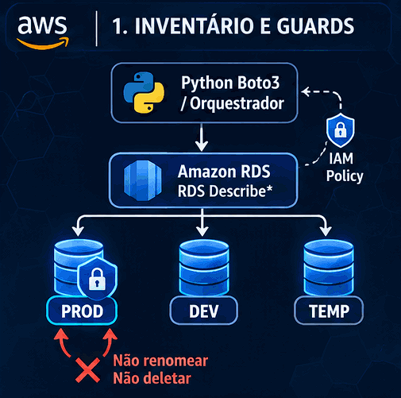
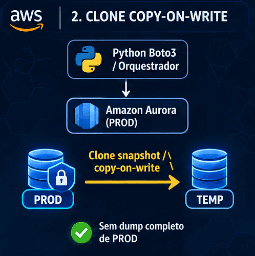
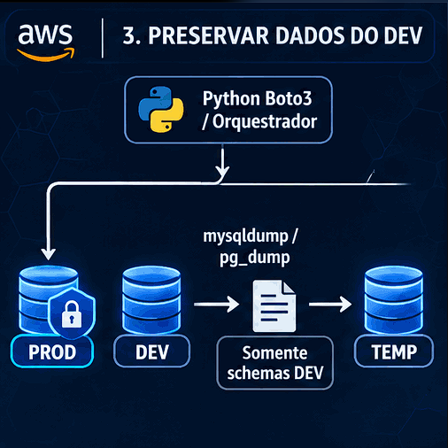
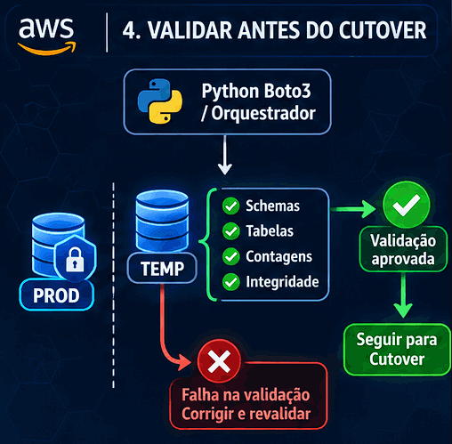
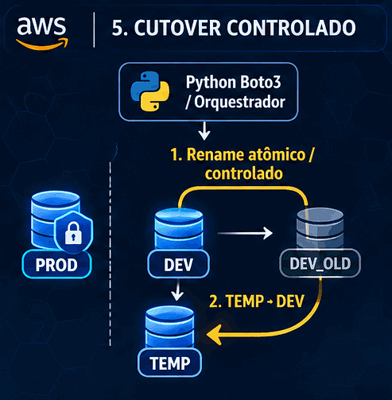
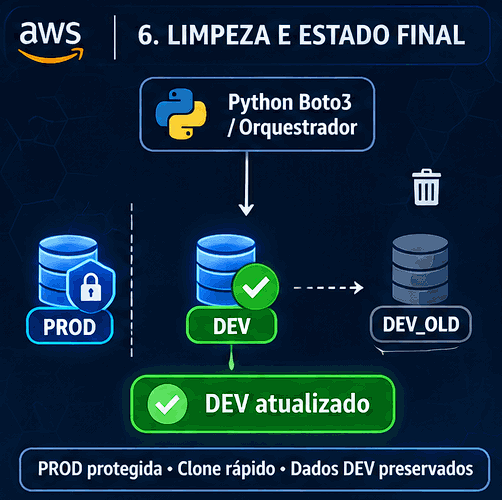

# Aurora Clone (Boto3)

Ajuda a manter a base de **desenvolvimento** o mais próxima possível da de **produção**, sem perder schemas/dados específicos do DEV e sem expor a PROD a rename/delete.

Feito para bancos Aurora/MySQL ou Aurora/PostgreSQL **pesados** (vários **GB** de dados), em que dump/restore completo de PROD é caro ou inviável no dia a dia. O fluxo usa clone copy-on-write (PROD → TEMP), reaplica só o dump dos schemas DEV no TEMP, valida contagens, faz o cutover por rename (DEV→OLD, TEMP→DEV) e remove o OLD — com inventário RDS, guards no código e policy IAM de proteção à PROD.

<table>
  <tr>
    <td align="center" width="33%">
      <br />
      <sub><b>1. Inventário e guards</b><br />Lista PROD/DEV/TEMP; bloqueia rename/delete em PROD</sub>
    </td>
    <td align="center" width="33%">
      <br />
      <sub><b>2. Clone copy-on-write</b><br />PROD → TEMP via API RDS, sem dump completo</sub>
    </td>
    <td align="center" width="33%">
      <br />
      <sub><b>3. Preservar dados do DEV</b><br />Dump só dos schemas exclusivos de DEV → TEMP</sub>
    </td>
  </tr>
  <tr>
    <td align="center" width="33%">
      <br />
      <sub><b>4. Validar antes do cutover</b><br />Schemas, tabelas, contagens e integridade</sub>
    </td>
    <td align="center" width="33%">
      <br />
      <sub><b>5. Cutover controlado</b><br />Rename DEV→OLD e TEMP→DEV</sub>
    </td>
    <td align="center" width="33%">
      <br />
      <sub><b>6. Limpeza e estado final</b><br />Remove OLD; DEV atualizado, PROD protegida</sub>
    </td>
  </tr>
</table>

> **AVISO IMPORTANTE — MasterUsername e senha**
>
> - **MasterUsername:** deve ser o **mesmo** em PROD e DEV. O job não lê usuário do `.env`; usa o `MasterUsername` do cluster na API RDS (`make list-rds` → `master_user`). No clone PROD → TEMP, o TEMP herda o master da PROD; no cutover isso vira o master do DEV. Se os nomes forem diferentes, apps/runbooks do DEV que usavam o nome antigo quebram.
> - **Senha:** a de DEV **não** precisa ser igual à de PROD. Passe só a senha operacional de DEV via `DB_PASSWORD` ou `DB_PASSWORD_SSM_PARAM` no `.env`. O job usa essa senha no login do DEV e, após o clone, redefine a senha do master do TEMP para ela. O script **não precisa** (e não deve receber) a senha de produção.
> - **Proteção de PROD:** mantenha a base de produção bem protegida pela policy IAM (ver [2. Verificar a policy de proteção](#2-verificar-a-policy-de-proteção) e [`role.md`](role.md)). Normalmente, PROD fica em **outra VPC**, evite caminho de rede a partir do container que executa o clone — o job clona via API RDS (copy-on-write), não precisa conectar no MySQL/PostgreSQL de PROD.
>
> Confira PROD vs DEV com `make list-rds` antes do primeiro pipeline.

## Requerimentos

Só é necessário o **Docker**. Os clusters precisam ser **Aurora MySQL** ou **Aurora PostgreSQL** (RDS “plain” MySQL/PostgreSQL não entra neste fluxo). O restante (Python, `make`, `mydumper`/`myloader`, `pg_dump`/`pg_restore`, clientes `mysql`/`psql`, Terraform e dependências) já vem na imagem.

## Tutorial

Na primeira vez, faça o clone do repo + build da imagem:

```bash
git clone https://github.com/AraujoDavies/AuroraCloneBoto3.git

cd AuroraCloneBoto3

cp .env.example .env

docker build -t aurora-clone .
```

Depois disso, suba o container no game (inspirado no anime Attack on Titan) para ajustar as variáveis de ambiente — o `-it` é obrigatório porque o game é interativo:

```bash
docker run --rm -it \
  --user "$(id -u):$(id -g)" \
  $([ -f .env ] && echo --env-file .env) \
  -v "$(pwd):/app" \
  -w /app \
  aurora-clone \
  make game
```


Ao concluir as fases do game, o ambiente está pronto. Em seguida, agende o [`make pipeline`](#depois-do-primeiro-run) — por exemplo com [Compose](#configurando-compose) ([`docker-compose.example.yml`](docker-compose.example.yml)) ou com outro serviço na AWS.

Não tem a infraestrutura montada no RDS? [Use o Terraform para criar 2 bancos de dados para o laboratório](#criando-ambiente-de-teste-com-terraform).

Quer mais detalhes? Continue pelo [Sumário](#sumário).

## Sumário

- [Requerimentos](#requerimentos)
- [Tutorial](#tutorial)
- [Configurando Compose](#configurando-compose)
- [Makefile (Comandos padronizados)](#makefile-comandos-padronizados)
  - [1. Conferir a conta AWS](#1-conferir-a-conta-aws)
  - [2. Verificar a policy de proteção](#2-verificar-a-policy-de-proteção)
  - [3. Listar clusters RDS](#3-listar-clusters-rds)
  - [4. Clone PROD → TEMP](#4-clone-prod--temp)
  - [5. Dump dos schemas DEV](#5-dump-dos-schemas-dev)
  - [6. Restore do dump no TEMP](#6-restore-do-dump-no-temp)
  - [7. Validar DEV vs TEMP](#7-validar-dev-vs-temp)
  - [8. Rename DEV → OLD](#8-rename-dev--old)
  - [9. Rename TEMP → DEV](#9-rename-temp--dev)
  - [10. Delete OLD](#10-delete-old)
  - [Depois do primeiro run](#depois-do-primeiro-run)
- [Criando ambiente de teste com Terraform](#criando-ambiente-de-teste-com-terraform)
- [Variáveis de ambiente](#variáveis-de-ambiente)
  - [AWS](#aws)
  - [Identificadores Aurora](#identificadores-aurora)
  - [Rede / instância do TEMP](#rede--instância-do-temp)
  - [Banco — MySQL ou PostgreSQL](#banco--mysql-ou-postgresql)
  - [Dump e validação](#dump-e-validação)
  - [Arquivo S3 (opcional)](#arquivo-s3-opcional)
  - [Segurança operacional](#segurança-operacional)
- [Comandos do Makefile](#comandos-do-makefile)

---

## Configurando Compose

Pré-requisito: ter executado o game antes e a imagem **`aurora-clone`** no Docker local (`docker build -t aurora-clone .`). O Compose **não** faz `build`; monta o projeto em `/app` (código + `.env` + dumps). 

```bash
cp docker-compose.example.yml docker-compose.yml
```

Ajuste o horário em `docker-compose.yml` no serviço `aurora-scheduler`:

| Objetivo | `SCHEDULE_CRON` (com `TZ`, ex. `America/Sao_Paulo`) |
| --- | --- |
| Diário às 03:00 | `0 3 * * *` |
| Semanal (domingo 03:00) | `0 3 * * 0` |
| Mensal (dia 1 às 03:00) | `0 3 1 * *` |

> For more information: https://crontab.guru/

`SCHEDULE_COMMAND` default: `make PYTHON=python pipeline`. Se um run ainda estiver em andamento no próximo tick, o agendador **pula** (lock em `.aurora_scheduler.lock`) — evita dois clones Aurora em paralelo.

O serviço usa `env_file: .env` e volume `.:/app`. Shell interativo / game continuam pelo [`docker run`](#tutorial) do tutorial.

```bash
docker compose up -d aurora-scheduler
docker compose logs -f aurora-scheduler
```

## Makefile (Comandos padronizados)

### 1. Conferir a conta AWS

Confirma Account, ARN e região carregados a partir do `.env`:

```bash
make PYTHON=python account-aws
```

### 2. Verificar a policy de proteção

Checa se a policy IAM `AvoidDeleteAuroraCloneBoto3` existe e está anexada à identity atual. Sem isso, não avance para passos que criam/renomeiam/apagaram recursos. Detalhes da role: [`role.md`](role.md).

```bash
make PYTHON=python check-policy
```

### 3. Listar clusters RDS

Confirme PROD e DEV `available`, subnet, security groups, `instance_class` e se o writer é público — útil para preencher o `.env` e `DEV_PUBLICLY_ACCESSIBLE`.

```bash
make PYTHON=python list-rds
```

### 4. Clone PROD → TEMP

Cria o cluster TEMP via PITR copy-on-write e sobe a writer. O TEMP herda o `MasterUsername` da PROD; em seguida o job redefine a senha master do TEMP para `DB_PASSWORD` e faz smoke login (até 5 tentativas, 30s entre falhas — propagação lenta da senha após `modify_db_cluster`). **Não** apaga nem altera PROD. Falha se `TEMP_IDENTIFIER` já existir.

```bash
make PYTHON=python clone-prod-to-temp
```

### 5. Dump dos schemas DEV

Descobre schemas exclusivos de DEV (`schemas(DEV) − schemas(TEMP)`; ou `DEV_SCHEMAS` se setado). Requer TEMP já criado (passo 4). Com `DEV_SCHEMAS` setado, a descoberta automática é desligada; mantenha a lista alinhada aos schemas exclusivos atuais do DEV.

- **Aurora MySQL:** `mydumper` → `DUMP_BASE_DIR/YYYYMMDD_HHMMSS/<schema>/`
- **Aurora PostgreSQL:** `pg_dump -Fc` → `DUMP_BASE_DIR/YYYYMMDD_HHMMSS/<schema>/<schema>.dump`

```bash
make PYTHON=python dump-dev
```

### 6. Restore do dump no TEMP

Reaplica só o que veio do dump DEV no endpoint TEMP.

- **MySQL:** `myloader --overwrite-tables`
- **PostgreSQL:** `pg_restore --clean --if-exists` no `*.dump`

```bash
make PYTHON=python restore-temp
```

### 7. Validar DEV vs TEMP

Compara `COUNT(*)` tabela a tabela nos schemas da pasta de run (`DUMP_BASE_DIR/YYYYMMDD_HHMMSS/<schema>/`, ou `DEV_SCHEMAS` se setado) — não usa `DEV − TEMP`. Se passar da tolerância (`ROW_DIFF_TOLERANCE`), o script **apaga TEMP** e aborta — DEV permanece intacto.

```bash
make PYTHON=python validate
```

Só continue o cutover se a validação passou.

### 8. Rename DEV → OLD

```bash
make PYTHON=python rename-dev-to-old
```

### 9. Rename TEMP → DEV

```bash
make PYTHON=python rename-temp-to-dev
```

### 10. Delete OLD

Com `KEEP_OLD_DEV_HOURS=0` (default), apaga o cluster/instância OLD. Com valor `> 0`, só loga e não apaga.

```bash
make PYTHON=python delete-old-dev
```

### Depois do primeiro run

Quando o fluxo manual estiver ok, o pipeline completo (mesma ordem) é:

```bash
make PYTHON=python pipeline
# ou
make PYTHON=python run
```

---

## Criando ambiente de teste com Terraform

**Terraform já está na imagem Docker.** Não precisa instalar no host. Rode `terraform` a partir de `infra/mysql` ou `infra/postgres`.

Lab barato para exercitar o fluxo sem tocar em clusters reais. Há um root Terraform por engine:

- [`infra/mysql`](infra/mysql) — Aurora MySQL Serverless v2
- [`infra/postgres`](infra/postgres) — Aurora PostgreSQL Serverless v2

Cada apply sobe **duas VPCs** (`...-{engine}-prod` e `...-{engine}-dev`) e **dois clusters** Aurora públicos (PROD + DEV). Os dois roots são **independentes** (state e apply separados).

Exemplos de nomes: `vpc-lab-aurora-clone-boto3-mysql-prod`, `vpc-lab-aurora-clone-boto3-mysql-dev` (o mesmo padrão com `postgres`). Identificadores default dos clusters: MySQL `prod-aurora` / `dev-aurora`; Postgres `prod-aurora-pg` / `dev-aurora-pg`.

Configuração econômica: Serverless v2 com **min 0 ACU / max 1 ACU** e **auto-pause após 10 minutos** sem conexão (`seconds_until_auto_pause = 600`). Se o lab ficar ocioso, o cluster pausa e para de consumir ACU; a próxima conexão pode demorar (cold start). Mesmo assim, rode `destroy` ao terminar o teste.

> [!WARNING]
> **Há custo enquanto a infra existir** — mesmo com o cluster pausado (storage e backup mínimos). Rode `destroy` ao terminar o teste.

### Subir

**Antes** de entrar no container, o `.env` no host já precisa ter as credenciais AWS preenchidas (passo 1 dos pré-requisitos). Sem isso — ou se o container subiu sem `--env-file .env` — o provider AWS falha com `Error: No valid credential sources found`.

```bash
docker run --rm -it \
  --user "$(id -u):$(id -g)" \
  $([ -f .env ] && echo --env-file .env) \
  -v "$(pwd):/app" \
  -w /app \
  aurora-clone
```
dentro do container... 

```bash
# Pré-requisito: shell aberto após docker run com --env-file .env (credenciais AWS no .env)
cd infra/mysql # ou cd infra/postgres
cp terraform.tfvars.example terraform.tfvars
```
Edite o arquivo terraform.tfvars caso queira mudar a senha, valor padrão do lab é:

  ***master_username*** = "labadmin"
  ***prod_master_password*** = "labadmin"
  ***dev_master_password***  = "labadmin-dev"

Suba a infra com terraform

```bash
terraform init
terraform apply
terraform output
```

O `.env` entra em **duas fases** no lab:

1. **Antes** do Terraform: credenciais AWS e região (já usadas neste shell).
2. **Depois** do `terraform output`: preencha no host os identificadores/senha do lab e, se o shell ainda estiver aberto, `exit` + novo `docker run` / Compose para o `make` também ver as novas variáveis.

Mapeamento dos outputs:

- `prod_cluster_identifier` → `PROD_IDENTIFIER`
- `dev_cluster_identifier` → `DEV_IDENTIFIER`
- `dev_master_password` do tfvars → `DB_PASSWORD` (senha operacional de DEV; login = `MasterUsername` do cluster no RDS — no lab PROD e DEV compartilham o mesmo `master_username`, mas **senhas distintas**)
- `prod_master_password` → guardar à parte (runbook / secrets); o job de clone **não** usa a senha de PROD

Alinhe também `TEMP_IDENTIFIER` e `OLD_IDENTIFIER` no `.env` com os defaults do Terraform (`temp-aurora` / `olddev-aurora` no MySQL; sufixo `-pg` no Postgres), ou override `temp_cluster_identifier` / `old_cluster_identifier` no `terraform.tfvars` se usar outros nomes.

Rede do TEMP (subnet/SG/class/público) **herda do DEV** por padrão.

### Remover

Ainda no container. Derruba clusters PROD/DEV do lab, VPCs e para a cobrança. Antes de soltar a rede do DEV, o destroy também tenta apagar clusters **TEMP** e **OLD** (criados pelo clone/rename fora do state), usando os identificadores do `terraform.tfvars` — cluster ausente não interrompe o fluxo.

```bash
cd infra/mysql   # ou infra/postgres
terraform destroy
```

MySQL e Postgres não se destroem juntos: rode `destroy` em cada pasta que você tiver aplicado. Credenciais AWS: mesma cadeia do apply (env do container).

---

## Variáveis de ambiente

Todas vêm do `.env` (veja `.env.example`). O script carrega o arquivo com `load_dotenv(override=True)`.

Copie o exemplo antes de preencher:

```bash
cp .env.example .env
```

### AWS

| Variável | O que faz | Se setar | Se não setar / vazio |
|----------|-----------|----------|----------------------|
| `AWS_ACCESS_KEY_ID` | Access key da conta | boto3 usa essa key | Cadeia padrão do boto3 (perfil, role da máquina, etc.) |
| `AWS_SECRET_ACCESS_KEY` | Secret da access key | boto3 usa esse secret | Idem |
| `AWS_DEFAULT_REGION` | Região dos clients RDS/IAM/STS | Clientes apontam para essa região | Tenta `AWS_REGION`; se ambas faltarem, default do boto3/config |

**OBS:** Em EC2 (ou ECS/ASG) com **IAM instance role**, não é necessário setar `AWS_ACCESS_KEY_ID` / `AWS_SECRET_ACCESS_KEY` — o boto3 usa a role via metadata. Ainda assim, defina `AWS_DEFAULT_REGION` (ou `AWS_REGION`). Se o `.env` trouxer keys preenchidas, `load_dotenv(override=True)` sobrescreve a role; nesse ambiente, omita essas linhas do `.env`.

### Identificadores Aurora

Um valor por papel: o **mesmo** nome para cluster e instância writer.

| Variável | O que faz | Se setar | Se não setar / vazio |
|----------|-----------|----------|----------------------|
| `PROD_IDENTIFIER` | Cluster/instância de produção (somente leitura/clone; nunca rename/delete) | Usado no clone e nos guards | Falha nos passos que exigem PROD |
| `DEV_IDENTIFIER` | Cluster/instância DEV atual | Dump, validate, rename DEV→OLD / TEMP→DEV | Falha nos passos que exigem DEV |
| `TEMP_IDENTIFIER` | Destino do clone (PITR) e do restore | Clone cria/usa esse nome; rename TEMP→DEV | Falha nos passos que exigem TEMP |
| `OLD_IDENTIFIER` | Nome temporário após rename DEV→OLD | Rename e delete OLD | Falha nos passos que exigem OLD |

### Rede / instância do TEMP

Opcionais: sem elas, o clone herda rede/porte/`PubliclyAccessible` do **DEV**. O `Engine` da writer TEMP vem sempre do cluster **PROD** (não há variável).

| Variável | O que faz | Se setar | Se não setar / vazio |
|----------|-----------|----------|----------------------|
| `DB_SUBNET_GROUP` | Subnet group do cluster TEMP no clone | Override no `restore_db_cluster_to_point_in_time` | Herda `DBSubnetGroup` do cluster **DEV** |
| `VPC_SECURITY_GROUP_IDS` | Security groups do TEMP (lista separada por vírgula) | Override no restore | Herda SGs do cluster **DEV** |
| `DB_INSTANCE_CLASS` | Classe da writer TEMP | Usada em `create_db_instance` | Herda class do writer **DEV**; se indisponível, `db.serverless` |
| `DEV_PUBLICLY_ACCESSIBLE` | `PubliclyAccessible` da writer TEMP no clone | `true`/`1`/`yes`/`on` → público; `false`/`0`/`no`/`off` → privado; outro valor → erro | Herda o valor do **writer de DEV**; se DEV não tiver o atributo, usa `false` (seguro) |

### Banco — MySQL ou PostgreSQL

O usuário de conexão é sempre o `MasterUsername` do cluster alvo (API RDS); não há variável de usuário no `.env`. Porta e família de dump vêm do `Engine` do RDS (MySQL → `mydumper`/`myloader`; PostgreSQL → `pg_dump`/`pg_restore`). Ver o aviso importante no início deste README.

| Variável | O que faz | Se setar | Se não setar / vazio |
|----------|-----------|----------|----------------------|
| `DB_PASSWORD` | Senha de **DEV** (não a de PROD) | Conecta com essa senha; no clone redefine `MasterUserPassword` do TEMP | Tenta SSM via `DB_PASSWORD_SSM_PARAM`; se ambos vazios → erro no início |
| `DB_PASSWORD_SSM_PARAM` | Path de um SecureString no Parameter Store | Usado só se `DB_PASSWORD` estiver vazio (`GetParameter` + decrypt) | Ignorado se `DB_PASSWORD` estiver setada |
| `DB_NAME` | Database PostgreSQL de conexão (`psql` / `pg_dump` / `psycopg2`) | Usa esse nome | Default: `postgres` (só PG; ignorado no MySQL) |

No início de clone/dump/restore/validate/pipeline o job resolve a senha (env → SSM) **antes** do trabalho caro. Dump no DEV usa o master do DEV; restore/sanitize/validate no TEMP usam o master do TEMP (= PROD após o clone). Confira com `make list-rds` (`master_user` / `engine` no log). PROD, DEV e TEMP devem ser da **mesma família** de engine.

### Dump e validação

| Variável | O que faz | Se setar | Se não setar / vazio |
|----------|-----------|----------|----------------------|
| `DEV_SCHEMAS` | Override da lista de schemas (vírgula) | **Lista fixa:** só esses schemas no dump/restore/validate. Schemas criados depois no DEV **não** entram até você atualizar a variável | Auto a cada run: `schemas(DEV) − schemas(TEMP)` (TEMP obrigatório; pega schemas novos exclusivos de DEV) |
| `DUMP_BASE_DIR` | Pasta base dos dumps (`DUMP_BASE_DIR/YYYYMMDD_HHMMSS/…`) | Grava nessa árvore | Default: `./dumps` |
| `DUMP_LOCAL_RETENTION_DAYS` | Apaga pastas de run locais com idade maior que N dias | Retenção customizada | Default: `15` |
| `ROW_DIFF_TOLERANCE` | Diferença máxima de linhas aceita no validate (por tabela) | Tolerância numérica | Default: `50` |
| `WAIT_TIMEOUT_SECONDS` | Timeout ao aguardar cluster/instância `available` | Limite em segundos | Default: `3600` |

> **Game — pasta de run fixa por campanha.**  
> O `make game` grava o segmento `YYYYMMDD_HHMMSS` em `.aurora_game_checkpoint` (`run_dump_dir`) e reutiliza a mesma pasta (log + dumps) ao reabrir, até resetar o progresso. `make pipeline` / CLI continuam criando um timestamp por execução.

> **ATENÇÃO —** `DEV_SCHEMAS` **é lista fixa.**  
> Se você preencher `DEV_SCHEMAS=schema1,schema2`, o job **não** descobre schemas novos no DEV. Qualquer schema criado depois (ex.: `schema3`) **fica de fora** do dump, do restore no TEMP e da validação de contagens, até a variável ser atualizada.  
> Prefira deixar `DEV_SCHEMAS` **vazio** (modo auto `DEV − TEMP`) salvo quando precisar forçar um subconjunto deliberado — e, nesse caso, revise a lista sempre que criar schema no DEV.

### Arquivo S3 (opcional)

No fim de `make pipeline` (e na etapa **ArchiveS3** do game), se `S3_BUCKET` estiver setada, o job sobe a pasta da execução: **primeiro** `pipeline.log`, **depois** os dumps (mydumper ou `*.dump` do `pg_dump`). Falha no upload vira `warning` e **não** interrompe o fluxo. `make dump-dev` sozinho não faz upload.

| Variável | O que faz | Se setar | Se não setar / vazio |
|----------|-----------|----------|----------------------|
| `S3_BUCKET` | Bucket de arquivo dos runs | Upload no fim da pipeline / etapa ArchiveS3 | Sem upload (ArchiveS3 conclui como “pulado”) |
| `S3_DUMP_PREFIX` | Prefixo de chave S3 (ex.: `aurora-clone/dev`) | Objetos em `s3://bucket/prefix/YYYYMMDD_HHMMSS/…` | Objetos em `s3://bucket/YYYYMMDD_HHMMSS/…` |

**Recomendação:** criar um **bucket dedicado** (não misturar com assets públicos), com **Block Public Access** ligado e **S3 Lifecycle** expirando objetos atuais em ~**30 dias**. A retenção local (`DUMP_LOCAL_RETENTION_DAYS`, default 15) é independente do lifecycle do bucket. Inclua `s3:PutObject` (e multipart) na role do job — `make generate-policy` adiciona o statement quando `S3_BUCKET` está no `.env` (ver [`role.md`](role.md)).

### Segurança operacional

| Variável | O que faz | Se setar | Se não setar / vazio |
|----------|-----------|----------|----------------------|
| `KEEP_OLD_DEV_HOURS` | Controla se `delete-old-dev` apaga de fato | Se `> 0`: só loga e **não** apaga OLD (útil para smoke/hold) | Default: `0` → apaga OLD normalmente |

### Compose — agendador (`aurora-scheduler`)

Usado só com `docker compose up -d aurora-scheduler` ([Configurando Compose](#configurando-compose)). Valores podem ir no `environment:` do Compose ou no `.env`.

| Variável | O que faz | Se setar | Se não setar / vazio |
|----------|-----------|----------|----------------------|
| `TZ` | Fuso para interpretar `SCHEDULE_CRON` | Horários no fuso escolhido (ex. `America/Sao_Paulo`) | Fuso padrão do container |
| `SCHEDULE_CRON` | Expressão cron (5 campos) | Dispara no padrão definido | O serviço não sobe (`scheduler.py` encerra) |
| `SCHEDULE_COMMAND` | Shell command no tick | Comando customizado | Default: `make PYTHON=python pipeline` |
| `SCHEDULE_LOCK_PATH` | Arquivo de lock (flock) | Caminho do lock | Default: `.aurora_scheduler.lock` |

---

## Comandos do Makefile

No container: `make PYTHON=python <alvo>`. No host com Poetry: `make <alvo>` (default).

| Alvo | Descrição |
|------|-----------|
| `make help` | Ajuda do script (`aurora_clone.py --help`) |
| `make account-aws` | Account/Arn AWS em uso |
| `make check-policy` | Policy `AvoidDeleteAuroraCloneBoto3` |
| `make list-rds` | Inventário de clusters/instâncias RDS |
| `make clone-prod-to-temp` | 1. Clone PROD → TEMP |
| `make dump-dev` | 2. Dump schemas DEV |
| `make restore-temp` | 3. Restore dump → TEMP |
| `make validate` | 4. Validar contagens DEV vs TEMP |
| `make rename-dev-to-old` | 5. Rename DEV → OLD |
| `make rename-temp-to-dev` | 6. Rename TEMP → DEV |
| `make delete-old-dev` | 7. Delete OLD |
| `make pipeline` / `make run` | Pipeline completo (passos 1–7) |
| `make test` | Suíte unitária (`pytest`; mesmo gate do `docker build`) |
